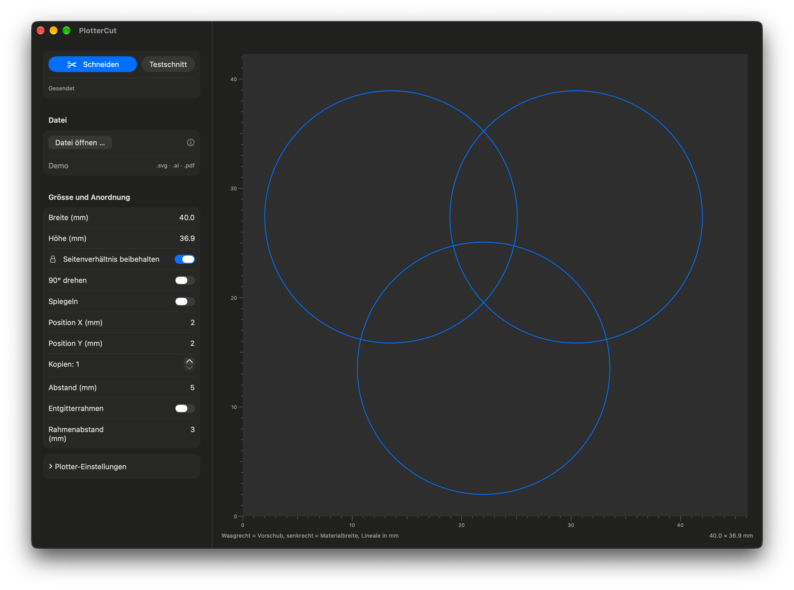

# PlotterCut



Schneidesoftware für macOS, mit der sich Schneideplotter direkt über einen USB-Seriell-Adapter ansteuern lassen. Entstanden als Ersatz für SignCut für den **Secabo C40**, funktioniert aber auch mit anderen Plottern, die HPGL oder DMPL verstehen.

## Funktionen

- Import von **.svg**, **.ai** (PDF-kompatibel) und **.pdf**
- Grösse direkt in mm, mit Seitenverhältnis-Schloss
- Drehen um 90°, Spiegeln, Position, Kopien, Entgitterrahmen
- Messerversatz-Kompensation, Overcut, Vorschub nach dem Schnitt
- Ausgabe als **DMPL** oder **HPGL**
- Vorschau mit Linealen in mm
- Einstellungen werden gespeichert

## Installation

1. Unter [Releases](../../releases) die neueste `PlotterCut-x.y.zip` herunterladen und entpacken.
2. `PlotterCut.app` in den Ordner **Programme** ziehen.
3. **Wichtig:** Die App ist nicht von Apple notarisiert. macOS meldet beim ersten Start deshalb, sie sei beschädigt oder könne nicht überprüft werden. Einmal im Terminal ausführen:

   ```bash
   xattr -cr /Applications/PlotterCut.app
   ```

   Danach startet die App normal. Der Befehl entfernt nur die Quarantäne-Markierung, die macOS an heruntergeladene Dateien hängt.

Läuft auf Apple Silicon und Intel.

## Was geschnitten wird

- Nur **Pfade** werden geschnitten.
- **Schrift** vorher in Pfade umwandeln, sonst wird sie ignoriert.
- **.ai** mit «PDF-kompatible Datei erstellen» speichern (Standard in Illustrator).
- Pixelbilder werden ignoriert.
- Schnittmasken werden nicht berücksichtigt: Verdecktes wird mitgeschnitten.
- Konturen werden auf ihrer Mittellinie geschnitten, die Strichstärke zählt nicht.

## Einstellungen für den Secabo C40

| Einstellung | Wert |
|---|---|
| Format | DMPL |
| Baudrate | 9600 |
| Handshake | RTS/CTS |
| Messerversatz | 0.30 mm |

Der C40 hat nur eine RS232-Schnittstelle. Am Mac braucht es einen USB-zu-RS232-Adapter, am besten mit FTDI-Chip. Er erscheint als `/dev/cu.usbserial-…`.

## Selbst bauen

Voraussetzung: Xcode.

```bash
git clone https://github.com/creisey/PlotterCut.git
cd PlotterCut
xcodebuild -project PlotterCut.xcodeproj -target PlotterCut -configuration Release SYMROOT="$PWD/build"
```

Die App liegt danach unter `build/Release/`. Die App Sandbox muss ausgeschaltet bleiben, sonst ist kein Zugriff auf den seriellen Port möglich.
